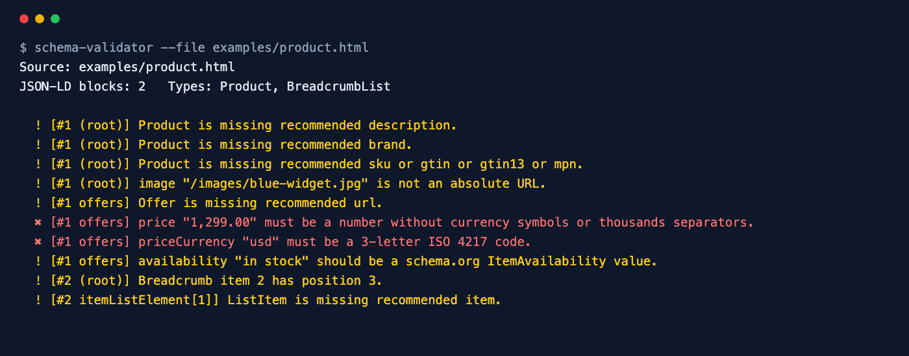

<div align="center">

# Schema Validator

**Validate JSON-LD structured data and catch what blocks your rich results.**

[](https://github.com/ksanyok/schema-validator/actions/workflows/ci.yml) [](LICENSE)   [](https://promopilot.link/en/tools/schema-validator.php?utm_source=github&utm_medium=repo&utm_campaign=tools&utm_content=schema-validator)

**[▶ Use the free online version — no install, no sign-up](https://promopilot.link/en/tools/schema-validator.php?utm_source=github&utm_medium=repo&utm_campaign=tools&utm_content=schema-validator)**

</div>

`schema-validator` pulls every `<script type="application/ld+json">` block out of a page (or reads a `.jsonld` file), parses it, walks nested objects and `@graph`, and checks each typed node against the properties Google requires and recommends for rich results. It also validates the values that most often break eligibility: ISO 8601 dates and durations, prices with currency symbols or thousands separators, lowercase currency codes, relative image URLs, ratings outside their scale and breadcrumb positions out of order.



## What it checks

- Every JSON-LD block parses as JSON (with line numbers), is not HTML-entity encoded and declares `@context: https://schema.org`
- Required and recommended properties for Product, Offer, AggregateOffer, AggregateRating, Review, Article (and NewsArticle, BlogPosting…), BreadcrumbList, FAQPage, Question/Answer, Organization, LocalBusiness (and Restaurant, Store…), Person, Event, Recipe, HowTo, VideoObject, JobPosting, WebSite, SoftwareApplication, Course, ImageObject
- Nested objects and `@graph` arrays, each reported with its JSON path
- Dates (`datePublished`, `startDate`, `uploadDate`…) in ISO 8601 and durations (`PT30M`) in ISO 8601
- Prices as plain numbers, `priceCurrency` as an ISO 4217 code, `availability` as a schema.org value
- Absolute URLs for `image`, `logo`, `url`, `item`, `sameAs`; ratings inside their scale; breadcrumb positions 1, 2, 3…
- Pages that use microdata or RDFa instead of JSON-LD

## Why it matters

Structured data is how a page earns stars, prices, breadcrumbs, FAQs and event dates in search results — and increasingly how AI assistants understand what a page offers. Rich results are all-or-nothing: one missing required property or a price written as `$1,299` and the whole item is ignored, with no visible sign on the page. Templates also break silently when a CMS field goes empty. Validating the JSON-LD of each template in CI catches these before Google does.

## Quick start

```bash
# run straight from GitHub, nothing to install
npx github:ksanyok/schema-validator https://example.com/product

# or install the CLI globally
npm install -g github:ksanyok/schema-validator
schema-validator https://example.com/product
```

Validate a local page or the bundled example:

```bash
schema-validator --file examples/product.html
```

Validate a JSON-LD file from your build:

```bash
schema-validator --file dist/schema/product.jsonld --strict
```

List every typed node:

```bash
schema-validator https://example.com/recipe --types
```

## Example output

```text
$ schema-validator --file examples/product.html
Source: examples/product.html
JSON-LD blocks: 2   Types: Product, BreadcrumbList

  ! [#1 (root)] Product is missing recommended description.
  ! [#1 (root)] Product is missing recommended brand.
  ! [#1 (root)] Product is missing recommended sku or gtin or gtin13 or mpn.
  ! [#1 (root)] image "/images/blue-widget.jpg" is not an absolute URL.
  ! [#1 offers] Offer is missing recommended url.
  ✖ [#1 offers] price "1,299.00" must be a number without currency symbols or thousands separators.
  ✖ [#1 offers] priceCurrency "usd" must be a 3-letter ISO 4217 code.
  ! [#1 offers] availability "in stock" should be a schema.org ItemAvailability value.
  ! [#2 (root)] Breadcrumb item 2 has position 3.
  ! [#2 itemListElement[1]] ListItem is missing recommended item.
```

## CLI

```text
Usage: schema-validator <url> [options]
       schema-validator --file page.html | data.jsonld

Extracts JSON-LD structured data from a page, checks JSON syntax, @context and
the required and recommended properties of types that power Google rich results
(Product, Offer, Article, FAQPage, BreadcrumbList, Organization, LocalBusiness,
Event, Recipe, VideoObject, JobPosting and more), plus dates, URLs and prices.

Options:
  --file <path>     Validate a local .html file or a .json/.jsonld file
  --types           List every typed node found
  --json            Print JSON
  --strict          Exit with code 1 on warnings too
  -h, --help        Show this help

Online version (no install): https://promopilot.link/en/tools/schema-validator.php?utm_source=github&utm_medium=cli&utm_campaign=tools&utm_content=schema-validator
```

## Use as a library

```js
import { validateUrl, validateHtml, validateJsonLd } from '@promopilot/schema-validator';

const r = await validateUrl('https://example.com/product');
console.log(r.types, r.issues);

// In a unit test of your template
const { issues } = validateJsonLd(JSON.parse(renderProductJsonLd(product)));
assert.deepEqual(issues.filter((i) => i.level === 'error'), []);
```

`validateUrl(url, { fetch })` and `validateHtml(html)` return `{ blocks, microdata, items[], types[], issues[], ok }`; every issue has `block`, `path`, `level`, `code` and `message`. `validateJsonLd(data)` validates one parsed object. The rule table is exported as `RULES` (and `ALIASES` for subtypes) so you can extend it.

## Use in CI (GitHub Actions)

Validate the structured data your build generates:

```yaml
on: [push]
jobs:
  schema:
    runs-on: ubuntu-latest
    steps:
      - uses: actions/checkout@v4
      - run: npm ci && npm run build
      - uses: ksanyok/schema-validator@v1
        with:
          args: --file dist/products/example/index.html
```

## How it works

JSON-LD blocks are located with a pattern for `script` tags of type `application/ld+json`, unwrapped from comment/CDATA wrappers and parsed with `JSON.parse`; if that fails, the tool tries again after decoding HTML entities to detect templates that escape their JSON. The parsed value is walked recursively and every object with an `@type` is checked against a rule table derived from Google Search Central's structured data documentation (`a|b` means either property is acceptable). Value checks use strict patterns for ISO 8601 and ISO 4217. It is a fast, offline linter for the most common rich result types — not a full schema.org vocabulary validator.

## CLI vs. online version

| | This package | [Online tool](https://promopilot.link/en/tools/schema-validator.php?utm_source=github&utm_medium=repo&utm_campaign=tools&utm_content=schema-validator) |
|---|---|---|
| Runs on | Your machine, CI, unit tests | Any browser |
| Input | URL, HTML, .jsonld | URL or pasted code |
| Output | Text with JSON paths, JSON, exit codes | Visual tree with explanations |
| Extras | Extensible rule table | Schema generator on the same site |
| Price | Free, MIT | Free, no sign-up |


## FAQ

<details>
<summary><b>Does passing this guarantee rich results?</b></summary>

No. Valid markup makes a page eligible; Google still decides whether to show rich results based on quality, policies and the query. Missing required properties, however, guarantees they will not show.
</details>

<details>
<summary><b>JSON-LD, microdata or RDFa?</b></summary>

Google recommends JSON-LD — it is separate from the HTML and easiest to maintain. This tool validates JSON-LD and only detects the other two formats.
</details>

<details>
<summary><b>Why is a relative image URL a problem?</b></summary>

Structured data is often processed apart from the page. Use absolute URLs (`https://…`) for images, logos and links.
</details>

<details>
<summary><b>Is FAQPage still worth adding?</b></summary>

Google shows FAQ rich results only for a limited set of authoritative sites now, but the markup is still valid and used by other consumers, including AI assistants.
</details>

<details>
<summary><b>Can I add my own types?</b></summary>

Yes — `RULES` is a plain object exported from the library. Add an entry with `required` and `recommended` arrays before calling the validator.
</details>

<details>
<summary><b>Is there a version without installing anything?</b></summary>

Yes — the [online Schema Validator](https://promopilot.link/en/tools/schema-validator.php?utm_source=github&utm_medium=repo&utm_campaign=tools&utm_content=schema-validator) runs the same checks in the browser and explains each result.
</details>

## Related free tools

- [Meta Tag Analyzer](https://promopilot.link/en/tools/meta-analyzer.php?utm_source=github&utm_medium=repo&utm_campaign=tools&utm_content=meta-analyzer) — title, description, canonical, robots and Open Graph
- [Schema Generator](https://promopilot.link/en/tools/schema-generator.php?utm_source=github&utm_medium=repo&utm_campaign=tools&utm_content=schema-generator) — build JSON-LD structured data
- [Open Graph Debugger](https://promopilot.link/en/tools/og-debugger.php?utm_source=github&utm_medium=repo&utm_campaign=tools&utm_content=og-debugger) — preview and validate social sharing tags
- [SERP Preview](https://promopilot.link/en/tools/serp-preview.php?utm_source=github&utm_medium=repo&utm_campaign=tools&utm_content=serp-preview) — see how a title and description look in Google
- [Sitemap Analyzer](https://promopilot.link/en/tools/sitemap-analyzer.php?utm_source=github&utm_medium=repo&utm_campaign=tools&utm_content=sitemap-analyzer) — validate XML sitemaps and sitemap indexes
- [All 120+ free SEO, email and web tools](https://promopilot.link/en/tools/?utm_source=github&utm_medium=repo&utm_campaign=tools&utm_content=schema-validator)

## Contributing

Bug reports and pull requests are welcome — see [CONTRIBUTING.md](CONTRIBUTING.md). Security issues: [SECURITY.md](SECURITY.md).
More docs live in the [wiki](https://github.com/ksanyok/schema-validator/wiki) (sources in [docs/wiki](docs/wiki)).

## License

[MIT](LICENSE) © 2026 Alexandr Krikun

---

<sub>Built and maintained by the team behind [PromoPilot](https://promopilot.link/?utm_source=github&utm_medium=repo&utm_campaign=tools&utm_content=schema-validator) — link building, SEO monitoring and 120+ free tools for site owners. Also on [YouTube](https://www.youtube.com/channel/UCPB8m7BgaexcZh0Vr49ViYA).</sub>
